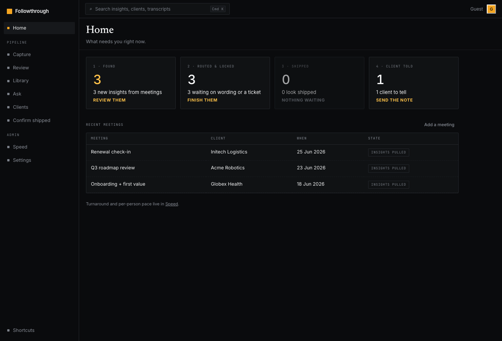
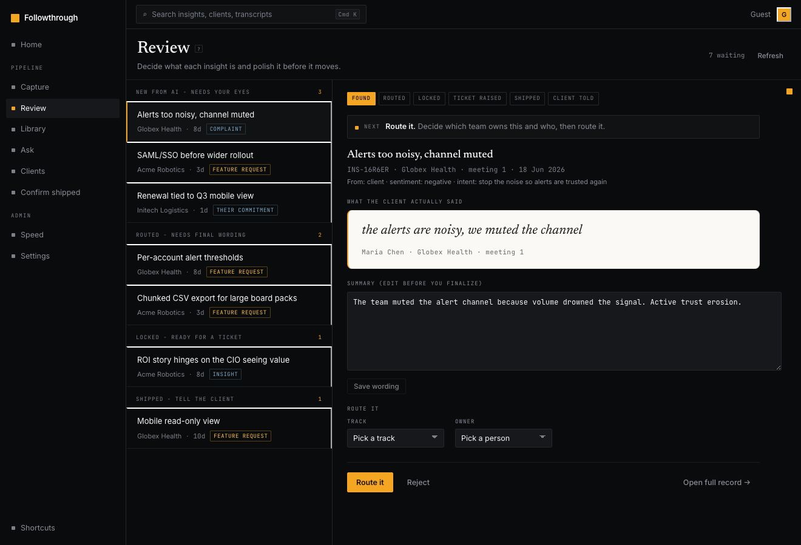
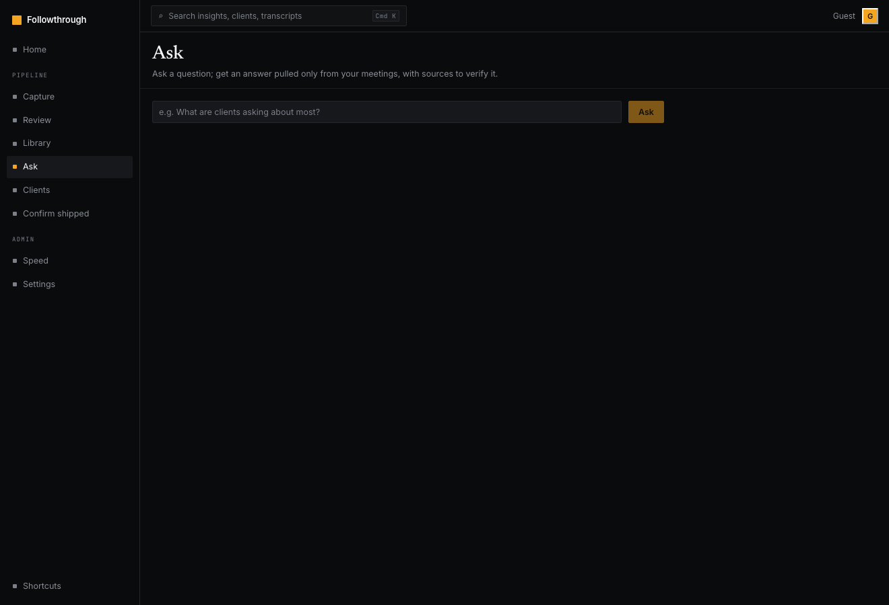
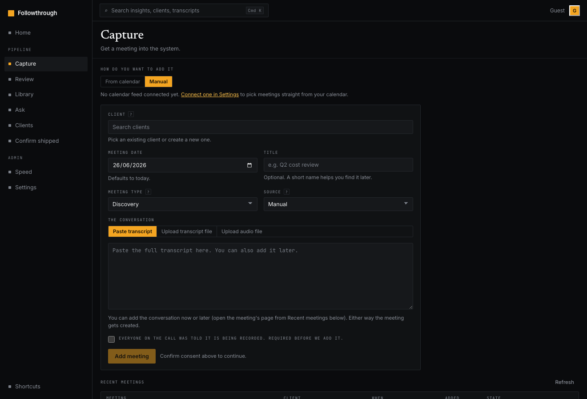
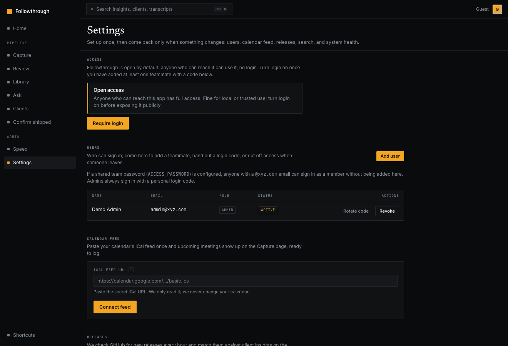
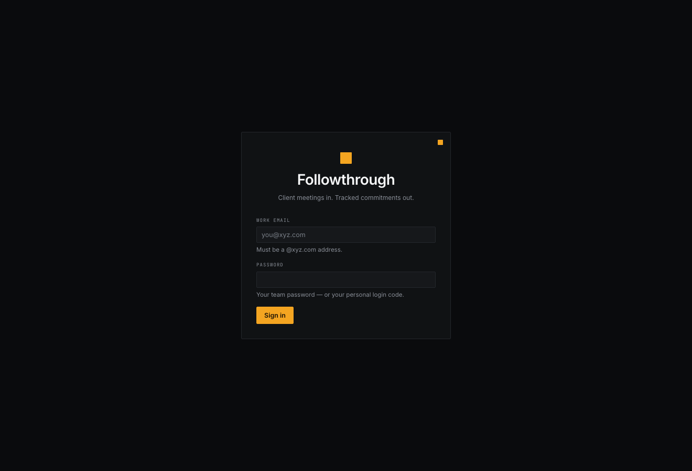

<div align="center">

# Followthrough

### Turn recorded client meetings into tracked, evidenced, closed-loop commitments.

[](LICENSE)
[](https://bun.sh)
[](https://www.typescriptlang.org/)
[](#development)
[](https://www.anthropic.com/)

*Meeting → extract → review → ticket → shipped → client told → closed. Every step timestamped.*

</div>

---

A salesperson promises a customer a feature on a call. Three weeks later it ships. Nobody tells the customer. The relationship quietly erodes. **Followthrough closes that loop.**

You feed it a meeting: transcript or audio. It extracts the real asks, complaints, and between-the-lines signals, each anchored to the client's exact words. A human reviews and polishes each one, routes it to a track, and moves it down a pipeline: ticket raised → proof it shipped → client told. Every transition is an event on an append-only log, so you can measure exactly how fast an ask travels from *said* to *shipped* to *told*, per client, per theme, per person.

> **The AI drafts; people decide.** Nothing reaches a client without a human confirming it. Every extracted insight must cite a verbatim quote from the transcript, or it doesn't exist.

> [!NOTE]
> All bundled data is **fictional**: the demo meetings in `demo/`, the eval transcripts and answer keys in `evals/golden/` (written by hand), and the release-note fixtures in `src/releases/fixtures/`. They are set around a made-up expense-software company, **Tallyhall**, and its made-up clients (Acme, Globex, Initech, Northwind Traders, Hooli, Vandelay Imports, Umbrella Freight). No real customer meetings are in this repo.

Product brief (user, problem, metrics, cost per meeting): [docs/PRD.md](docs/PRD.md).

---

## Why AI here, why code there

| Step | Done by | Why |
|---|---|---|
| Pull asks, complaints and commitments out of a transcript; verify them; draft tickets, emails and the meeting brief | Model (`src/extract/`, `src/emails/`, `src/tickets/`) | Reading intent and subtext from speech is a language task. |
| Keep an item only if its quote appears word for word in the transcript | Code (`buildQuoteMatcher` in `src/extract/segment.ts`) | Whether a quote exists is a fact to check, not a judgment. No quote, no item. |
| Triage, reword, route and finalize; confirm a release really shipped an ask | A person (Review and Confirm shipped screens) | The client relationship is on the line, so a human signs off every outward step. |
| Pipeline state, allowed transitions, and every turnaround time | Code (`src/events.ts`, `schema.sql`, `src/metrics/queries.ts`) | Timings must be exact and auditable, so they come from an append-only event log. |

## Evals

4 fictional calls with 24 expected asks, complaints and commitments (21 written down before the run, 3 added after review), including a friendly check-in with nothing actionable and a transcript carrying a prompt injection. Method and every miss: [EVALS.md](EVALS.md).

| Measure | Prompt v5 | Prompt v6 |
|---|---|---|
| Extracted items that are real (precision) | 24 / 34 (71%) | 22 / 22 (100%) |
| Expected items found (recall) | 24 / 24 (100%) | 22 / 24 (92%) |
| Items from the nothing-actionable call | 4 | 0 |
| Injected instruction turned into an item | Yes (reported, not obeyed) | No |

v5 rescored by hand on the corrected key; v6 is a live run. In v6 the code-side injection guard did not fire: the model never proposed the injected line as an item.

v6 traded some recall for precision: it merges or skips secondary commitments, which is the next fix. The prompt was tuned on these same 4 calls, so a held-out set is still needed. Run through the Claude Code CLI with the app's own prompts, not the production API path; an API rerun is planned.

---

## The pipeline

```
meeting ─▶ extract ─▶ review/finalize ─▶ ticket ─▶ shipped (proof) ─▶ client told ─▶ closed
            (AI)        (human gate)      (human)    (changelog match)   (email copy)
```

Each arrow is a tracked, timestamped state transition. The funnel, the turnaround times, and the per-client closed-loop rate all fall out of the event log for free.

---

## Screenshots

The "Transcript Spine" UI: cinematic dark chrome, a single signal-amber accent, editorial serif headers, and a single plain-English vocabulary.

| Home (what needs you now) | Review (triage workspace) |
|:---:|:---:|
|  |  |

| Ask (cited Q&A over your meetings) | Capture (get a meeting in) |
|:---:|:---:|
|  |  |

| Settings (open by default; login is optional) | Sign in (only when login is required) |
|:---:|:---:|
|  |  |

> Screenshots use the fictional demo data (clients Acme, Globex and Initech). A fresh install starts with an empty database; `bun run seed:demo` loads the demo.

---

## Why it's different

| Most "meeting summarizers" | Followthrough |
|---|---|
| One-shot "summarize this call" → mush | Multi-pass, typed extraction with an independent verifier |
| Hallucinated takeaways | **Citation gate**: no verbatim quote, no insight, enforced in code |
| A summary you read once and lose | A pipeline that tracks each ask until the client is told |
| Auto-sends / auto-files | Human gate at every outward step; AI never contacts a client |
| Timestamps maintained by hand | Append-only event log is the single source of truth |
| Black-box "AI quality" | An eval harness (`bun run evals`) that scores recall, precision & citation validity, run by hand after a prompt change |

---

## Quick start

**Prerequisites:** [Bun](https://bun.sh) 1.3+. macOS or Linux.

```bash
git clone https://github.com/avinashgaurav/followthrough.git
cd followthrough
bun install

# Set your LLM key (one of these). Goes in .env, which is gitignored.
echo 'ANTHROPIC_API_KEY=sk-ant-...'    >> .env   # preferred (direct Anthropic)
# or
echo 'OPENROUTER_API_KEY=sk-or-...'    >> .env   # fallback, pinned to Claude, retention denied

# Tell the AI who it works for (see .env.example for every option)
echo 'PRODUCT_NAME=Acme'                 >> .env

# Build the web UI
bun run build:web

# Start the server (serves the API and the built UI on one port)
bun run start            # http://localhost:4500
```

The app serves on `http://localhost:4500` by default (set `PORT` to change it). **It's open by default**: no login required, and every visitor is an admin. Fine on your laptop; **turn on Require login before exposing it to the internet.** When you're ready to lock it down, go to **Settings → Access**, add a teammate (you get a one-time login code), then turn **Require login** on. Login is email + code. Any email can hold an account unless you set `ALLOWED_EMAIL_DOMAINS` (e.g. `acme.com`). You can also seed a first admin from the CLI with `bun run seed`.

<details>
<summary><b>Optional setup</b> (local transcription, backups, env vars)</summary>

```bash
# Local transcription for audio-only uploads: open source, no API key, audio never leaves your machine
bash scripts/setup-whisper.sh

# Nightly backups (SQLite snapshot + blob sync; restore notes in scripts/RESTORE.md)
bun run backup
```

| Env var | Purpose |
|---|---|
| `PORT` | server port (default `4500`) |
| `DATA_DIR` | where the SQLite database and blobs live (default `./data`) |
| `LLM_MODEL` | Anthropic model id (default `claude-opus-4-8`); `OPENROUTER_MODEL` is the OpenRouter equivalent (default `anthropic/claude-opus-4.8`) |
| `PRODUCT_NAME` | your company or product; the AI frames every insight and email around it (e.g. `Acme`) |
| `PRODUCT_DESCRIPTION` | one line on what you sell (e.g. `a payroll platform for SMBs`) |
| `ALLOWED_EMAIL_DOMAINS` | comma-separated domains allowed to hold accounts (e.g. `acme.com,acme.io`); unset = any email |
| `RELEASE_REPO` | `owner/name` of the GitHub repo whose releases are matched against client asks; unset = poller off (paste changelogs manually) |
| `WRITABLE_REPOS` | comma-separated `owner/name` repos the tool may create issues in; unset = direct creation off (copy-paste still works) |
| `BLOCKED_ORGS` | comma-separated GitHub orgs never written to, even if allowlisted |
| `GITHUB_READ_TOKEN` | poll a releases repo for changelog matching |
| `GITHUB_WRITE_TOKEN` | direct ticket creation in an allowlisted repo only |
| `DIGEST_WEBHOOK_URL` | Slack / Google Chat webhook for the weekly digest + nudges |
| `WATCH_DIR` | folder to auto-ingest dropped recordings |
| `DEEPGRAM_API_KEY` | cloud STT alternative to local whisper |
| `DEEPGRAM_KEYTERMS` | comma-separated terms to boost Deepgram accuracy (names, jargon) |
| `DEMO_MODE` | `true` = public read-only demo: writes and login off, team and calendar hidden, Ask rate-limited per IP, background jobs off |
| `DEMO_ASK_PER_HOUR` | Ask questions per visitor IP per hour in demo mode (default `10`) |
| `DEMO_ASK_GLOBAL_PER_HOUR` | Ask questions per hour across all visitors in demo mode (default `200`) |
| `LLM_DAILY_BUDGET_USD` | hard daily cap on AI spend; once reached, AI calls return 503 until the next UTC day (resets on restart). Demo mode defaults to `5` |
| `TRUSTED_PROXY_HOPS` | proxies in front of the server that append to `X-Forwarded-For` (default `1`, right for Railway/Render/Fly; `0` ignores XFF). Drives login lockout and demo rate limits |
| `TRUST_CF_CONNECTING_IP` | `true` only when the server is reachable solely through Cloudflare |
| `ACCESS_PASSWORD` | optional shared team password: any allowed-domain email + this signs in as a member. **Set `ALLOWED_EMAIL_DOMAINS` too**, or the password alone admits any email |

</details>

---

## Run a public demo

`DEMO_MODE=true` turns an instance into a read-only showcase, and `bun run seed:demo` fills an empty database with three fictional client meetings (Acme, Globex, Initech for a made-up product, Tallyhall) run through the real extraction pipeline, plus a changelog that ships two of the asks and a closed loop for one client. The Docker image runs the demo seed automatically on first boot when `DEMO_MODE` is on.

```bash
DEMO_MODE=true LLM_DAILY_BUDGET_USD=5 PRODUCT_NAME=Tallyhall bun run seed:demo && bun run start
```

Seeding makes real LLM calls once and is all-or-nothing: a failure leaves the database untouched and the next boot retries. Mount a persistent volume at `DATA_DIR`, or every redeploy re-seeds (and re-spends). Demo mode caps AI spend at $5/day unless `LLM_DAILY_BUDGET_USD` says otherwise.

---

## How you use it: the tabs

The sidebar *is* the pipeline, top to bottom. Press `?` for shortcuts, `Cmd/Ctrl-K` for the command palette.

| Tab | What it's for |
|---|---|
| **Home** | The "what needs you right now" dashboard: the pipeline at a glance (found → routed → shipped → client told), recent meetings, and a jump straight into the queue. |
| **Capture** | Get a meeting in, from your calendar or manually. Type-ahead the client, confirm consent, paste a transcript or upload audio, then extract. |
| **Review** | The split-pane triage screen. Queue grouped by what needs you (*New from AI*, *Needs final wording*, *Ready for a ticket*, *Confirm it shipped?*, *Tell the client*). Polish, route, finalize. Brief-first: triage or reject many insights from one meeting in a single pass. `j`/`k` to move, `Enter` to open. |
| **Ask** | Ask a plain-English question and get an answer drawn **only** from your own meetings and insights, every claim cited back to the exact insight or transcript so you can verify it. Search finds the sources in your own database; the model only writes the answer from them. |
| **Library** | Everything ever learned, filterable and searchable across transcripts and quotes. |
| **Clients** | Per client: meeting timeline, every open ask, the promise ledger, a one-click pre-call brief, CSV export for your CRM, and a shareable client-facing "you asked, we shipped" page. |
| *Meeting page* | Opened from any meeting row (not a sidebar tab). A single meeting's full readout: transcript, the brief, and every insight it produced, each attributed to a side (client vs us) with sentiment and intent. |
| **Confirm shipped** | When a release ships, the system proposes which client asks it closes, with changelog evidence and a confidence score. Confirm to mark *shipped* and unlock the client email. |
| **Speed** *(admin)* | Turnaround times per stage, the funnel, what's stuck, demand by theme, per-person throughput, per-client closed-loop rate, AI quality. Every metric has a plain-words tooltip. |
| **Settings** *(admin)* | Access mode (open vs login-required), teammates, calendar feed, release polling, digest preview, rebuild search, and system health. |

---

## What makes the extraction good

One-shot summarization produces mush. The pipeline is multi-pass and verified (`src/extract/`):

1. **Clean & chunk** the transcript into 12,000-character windows with 1,000 characters of overlap, so long calls fit; mixed English/Hindi quotes preserved verbatim.
2. **Typed extraction**: each item has a specific type (feature request, complaint, key insight, our action, their commitment) and captures the subtext: fears, internal politics, ROI pressure, frustration with incumbents. Each item is also attributed: **side** (client vs us, inferred from speaker labels + the attendee list), **sentiment**, and the client's underlying **intent**. The pass is deliberately selective: only decision-grade items, no small talk or restated points.
3. **Citation gate**: every item must carry a verbatim quote *checked in code to exist in the transcript*. No quote, no insight. This removes invented quotes by construction; the verifier deals with weak readings of real quotes.
4. **Verifier pass**: an independent LLM judge drops items whose quote doesn't support the claim, or whose type is wrong.
5. **Dedup / merge**: a repeat ask attaches as a new mention on the existing insight (the "requested by N clients" signal) instead of a duplicate.
6. **Meeting brief**: a chief-of-staff synthesis: key readings, between the lines, lessons, action items grouped by owner team.

**The eval flywheel:** every human edit and discard during Review is captured. `evals/` drafts golden cases from your transcripts and scores recall, precision, citation validity, and type accuracy when you run `bun run evals` after a prompt change (it needs an LLM key, so CI does not run it). See [`evals/README.md`](evals/README.md).

---

## Architecture

One runtime, one source of truth.

- **Bun + TypeScript** end to end: `Bun.serve` HTTP server, `bun:sqlite` database (WAL).
- **React + Vite** SPA in `web/`, served from `web/dist` by the same server. Dark-only, single-accent, `Cmd-K` command palette, vim-style keyboard nav.
- **The event log is the source of truth.** `events` is an append-only table (enforced by triggers); an insight's state is a *cache* written in the same transaction as its event. Every turnaround-time metric is a query over the log, never a hand-maintained timestamp column. See `schema.sql` and `src/events.ts`.
- **LLM**: Anthropic direct (or OpenRouter pinned to Claude, retention denied). Structured outputs via Zod schemas, adaptive thinking, and a per-call cost log. Default model `claude-opus-4-8`. `src/llm/provider.ts`.
- **Storage**: metadata and transcripts in SQLite; audio/screenshots/CSVs as content-addressed blobs behind `media_assets` (local disk now, S3-ready).

<details>
<summary><b>Module map</b> (<code>src/</code>)</summary>

| Module | Responsibility |
|---|---|
| `auth`, `auth-routes` | email + login-code auth, optional shared-team password, sessions, rate-limited login, email-domain lock |
| `ingest` | clients, contacts, meetings, uploads, transcripts, dedup |
| `extract` | the multi-pass extraction pipeline + meeting brief |
| `insights` | triage, bulk triage/reject, finalize, merge, lifecycle, my-queue, full-text search, ask-your-memory (Q&A) |
| `tickets` | draft-first GitHub issues; org-safety write allowlist |
| `evidence`, `emails` | completion evidence (all tracks) and client follow-up drafts |
| `releases` | release poller + manual changelog intake + matcher + confirm queue |
| `share` | tokenized, public client-facing "you asked, we shipped" page |
| `metrics`, `exports`, `digest` | admin dashboard, CSV export, weekly digest |
| `notify` | fire-and-forget Slack / Google Chat nudges (extraction + daily summary) |
| `calendar` | read-only iCal intake for capture prefill (with SSRF guard) |
| `stt` | transcription: local whisper.cpp, or Deepgram cloud STT when a key is set |
| `watchfolder`, `retention` | folder auto-ingest; consent/deletion purge |

</details>

---

## Safety, by construction

- **Never writes to a protected GitHub org.** Direct ticket creation only reaches repos in `WRITABLE_REPOS`, and orgs in `BLOCKED_ORGS` are refused even if listed. Both are read at startup; there is no runtime override. Tickets are draft-first.
- **Consent gate.** A meeting can't be processed until consent is confirmed at upload.
- **No auto-send.** The confidence score only *suggests* "shipped"; a human confirms before any client email exists. Copy-to-clipboard is the send proxy, and the copy moment is the tracked timestamp.
- **Retention.** A meeting can be purged (audio, transcript, derived quotes) while keeping the insight record. `DELETE /api/meetings/:id`.

---

## Development

```bash
bun run dev            # server with --watch
cd web && bun run dev  # vite dev server, proxies /api to :4500
bun test               # 331 tests
bunx tsc --noEmit      # typecheck
bun run evals          # extraction quality scoring (needs an LLM key)
```

CI (`.github/workflows/ci.yml`, on pushes to `main` and on pull requests) typechecks the server, web app and extension, runs the test suite, and builds the web app and extension. It does not run the LLM evals.

The full product contract lives in [`SPEC.md`](SPEC.md). Design references are in [`design-reference/`](design-reference/).

---

## License

[MIT](LICENSE) © 2026 Avinash Gaurav
