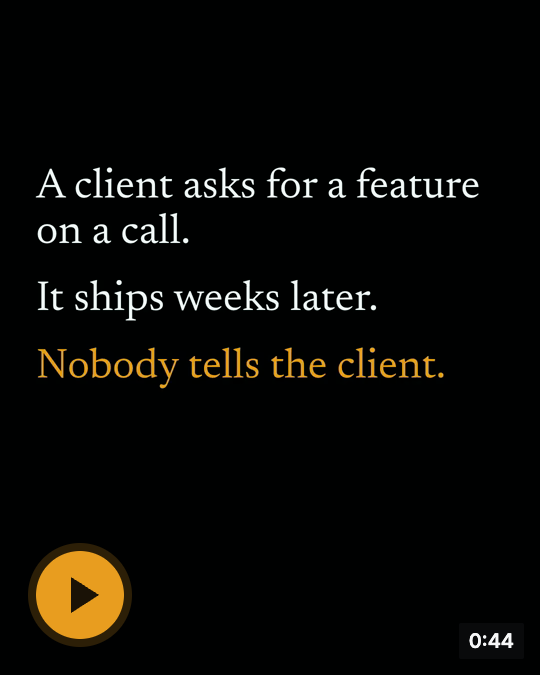
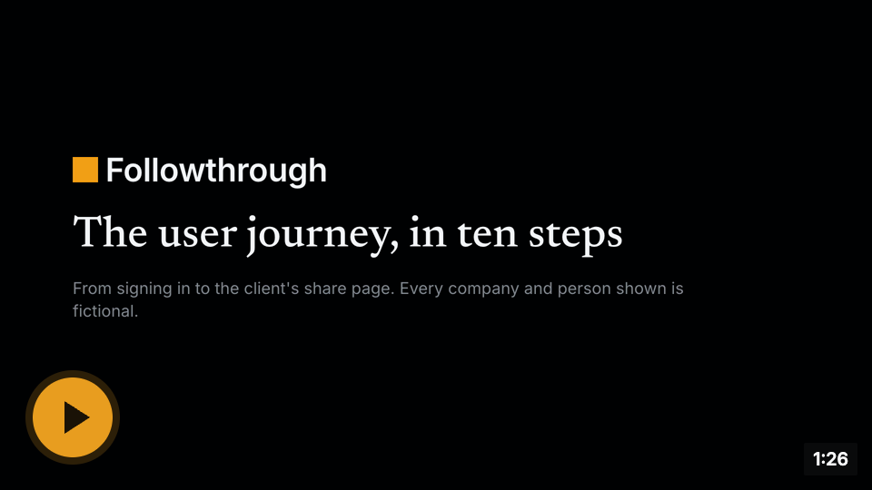
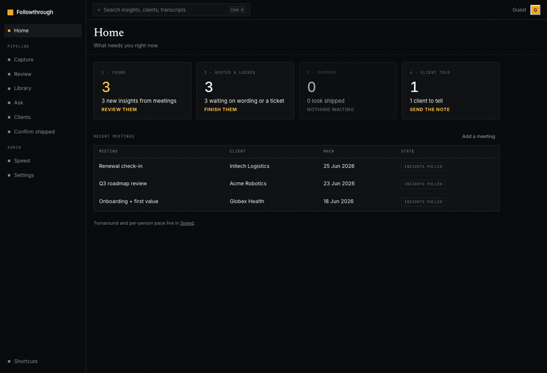

<div align="center">

# Followthrough

[](LICENSE)
[](https://bun.sh)
[](https://www.typescriptlang.org/)
[](docs/SETUP.md#development)
[](https://www.anthropic.com/)

</div>

A client asks for a feature on a call, it ships weeks later, and nobody tells the client; Followthrough tracks each ask from the client's exact words to "shipped" to "client told".

## Watch

<p>
  <a href="https://followthrough-eight.vercel.app/#watch"></a>
  &nbsp;
  <a href="https://followthrough-eight.vercel.app/#watch"></a>
</p>

Click a poster to play it on the site.

- **Launch video** (44 s): The problem in three lines, then the loop: paste in the call, no quote means no item, a person signs off, proof it shipped, ask your meetings, tell the client. Ends with the test result on 4 new made-up calls: 100% of flagged items right, 76% of expected items found. [Or download the MP4](https://github.com/avinashgaurav/followthrough/releases/download/demo-videos-2026-11-04/FollowThrough-brag.mp4).
- **User journey** (86 s): Ten steps on fictional data: sign in, Home, Review, Library and search, Ask, Confirm shipped, client page, Capture, the AI pulling out the asks, and the client's share page. Ends with what needs setup. [Or download the MP4](https://github.com/avinashgaurav/followthrough/releases/download/demo-videos-2026-11-04/FollowThrough-user-journey.mp4).

## Try it

Open the read-only demo at https://followthrough-demo-neon.vercel.app. It uses fictional meetings, needs no login, and saves nothing you do.

1. **Home:** what needs you now, and the pipeline from found to client told.
2. **Review:** the asks found in each call, with the client's exact quote behind every one.
3. **Library:** everything learned, searchable across transcripts and quotes.
4. **Ask:** try an example question; the answer cites the meetings it came from.
5. **Confirm shipped:** releases matched to the client asks they close, with changelog evidence.
6. **A client's share page** (from Clients): what they asked for and what shipped.

Want to paste in your own call? [Ask for a login](https://github.com/avinashgaurav/followthrough/issues/new?title=Demo%20login%20request&body=I%27d%20like%20a%20login%20to%20the%20hosted%20demo%20so%20I%20can%20paste%20in%20my%20own%20call.%0A%0ANo%20need%20to%20post%20your%20email%3B%20we%27ll%20reply%20on%20this%20issue.) to the hosted demo and paste it in there. No need to post your email; we'll reply on the issue. Or [run your own](#run-your-own).

## Good to know

- **Works today:** capture by pasting a transcript, AI extraction with quotes, Review, Library, Ask, Confirm shipped, client pages and share links.
- **The read-only demo:** shows the results with fictional data. Pasting your own call and asking new questions need a login or your own copy.
- **Needs setup when you run your own:** audio transcription (a Deepgram key), GitHub release matching (GitHub tokens), and sign-in codes, which an admin issues.

> [!TIP]
> **In pilot:** a sales team is trying followthrough on its own client calls.



> [!NOTE]
> **How well it works.** It was tested on 4 made-up calls with 24 expected requests, complaints and commitments. One call has nothing to act on. One transcript contains planted instructions for the AI (a prompt injection).
>
> | Measure | Prompt v5 | Prompt v6 |
> |---|---|---|
> | Of the items it flagged, how many were right (precision) | 24 / 34 (71%) | **22 / 22 (100%)** |
> | Of the items it should have found, how many it found (recall) | 24 / 24 (100%) | **22 / 24 (92%)** |
> | Items pulled from the call with nothing to act on | 4 | **0** |
> | Planted instruction turned into an item | Yes (reported, not followed) | **No** |
>
> **Test on new calls** (4 new made-up calls the tool had never been tuned on, 38 expected items; the correct answers were saved before the AI saw any call, the prompt was not changed, and the test ran 3 times): every item it flagged was right in every run (**100%**). It found **76%** of expected items (71% to 79%). It pulled nothing from the call with nothing to act on, and the planted instruction never became an item. The missed items come from one known weakness: when one person makes two commitments, v6 often merges the second into the first.
>
> Limits: the data is made up. The tests ran through the Claude Code command-line tool, not the way the live app calls the AI. The v5 and v6 columns use the 4 calls the prompt was tuned on. The correct answers for the new calls were written by the author. How it was tested, and every miss: [EVALS.md](EVALS.md).

## Why AI here, why code there

| Step | Done by | Why |
|---|---|---|
| Pull asks, complaints and commitments out of a transcript; verify them; draft tickets, emails and the meeting brief | Model (`src/extract/`, `src/emails/`, `src/tickets/`) | Reading intent and subtext from speech is a language task. |
| Keep an item only if its quote appears word for word in the transcript | Code (`buildQuoteMatcher` in `src/extract/segment.ts`) | Whether a quote exists is a fact to check, not a judgment. No quote, no item. |
| Triage, reword, route and finalize; confirm a release really shipped an ask | A person (Review and Confirm shipped screens) | The client relationship is on the line, so a human signs off every outward step. |
| Pipeline state, allowed transitions, and every turnaround time | Code (`src/events.ts`, `migrations/001_init.sql`, `src/metrics/queries.ts`) | Timings must be exact and auditable, so they come from an append-only event log. |

## Run your own

To process your own calls, run your own copy. It deploys to **Vercel with Supabase** (Postgres + file storage): import the repo, add Supabase from the Vercel Marketplace, set an AI key (`GEMINI_API_KEY`, `ANTHROPIC_API_KEY` or `OPENROUTER_API_KEY`), `PRODUCT_NAME` and `CRON_SECRET`, and deploy. Step by step: [docs/SETUP.md](docs/SETUP.md).

Locally, with [Bun](https://bun.sh) 1.3+ and a Postgres URL:

```bash
git clone https://github.com/avinashgaurav/followthrough.git && cd followthrough
bun install
printf 'DATABASE_URL=postgres://...\nGEMINI_API_KEY=...\n' >> .env
bun run build:web && bun run start   # http://localhost:4500, open by default: turn on Require login before exposing it
```

## More

- [docs/PRD.md](docs/PRD.md): product brief: user, problem, metrics, cost per meeting.
- [EVALS.md](EVALS.md): how the tests were run, the results and every miss.
- [docs/DESIGN-NOTES.md](docs/DESIGN-NOTES.md): screenshots, how it differs from a summarizer, and what each screen is for.
- [docs/ARCHITECTURE.md](docs/ARCHITECTURE.md): the pipeline, multi-pass extraction, runtime and safety rules.
- [docs/SETUP.md](docs/SETUP.md): deploying on Vercel + Supabase, running locally, every env var, public demo mode, development.
- [SPEC.md](SPEC.md): the full product contract.

## License

[MIT](LICENSE) © 2026 Avinash Gaurav
