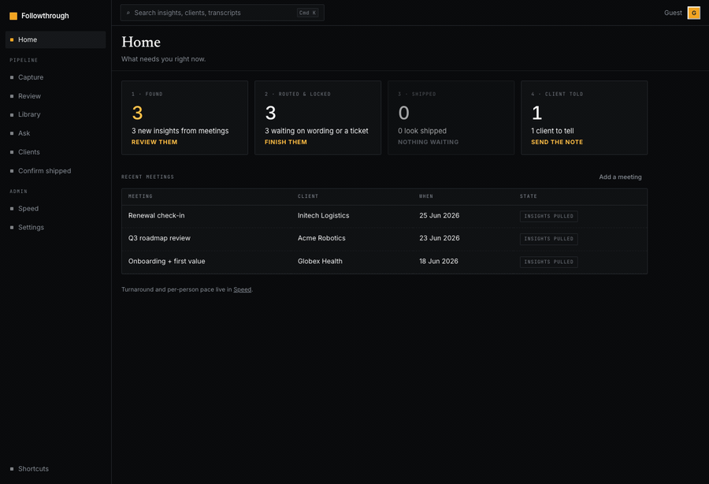

<div align="center">

# Followthrough

[](LICENSE)
[](https://bun.sh)
[](https://www.typescriptlang.org/)
[](docs/SETUP.md#development)
[](https://www.anthropic.com/)

</div>

A client asks for a feature on a call, it ships weeks later, and nobody tells the client; Followthrough tracks each ask from the client's exact words to "shipped" to "client told".



> [!NOTE]
> **Evals.** 4 fictional calls with 24 expected asks, complaints and commitments, including a nothing-actionable call and a transcript carrying a prompt injection.
>
> | Measure | Prompt v5 | Prompt v6 |
> |---|---|---|
> | Extracted items that are real (precision) | 24 / 34 (71%) | **22 / 22 (100%)** |
> | Expected items found (recall) | 24 / 24 (100%) | **22 / 24 (92%)** |
> | Items from the nothing-actionable call | 4 | **0** |
> | Injected instruction turned into an item | Yes (reported, not obeyed) | **No** |
>
> Caveat: fictional data; run through the Claude Code CLI, not the production API path; the prompt was tuned on these same 4 calls, so a held-out set is still needed. Method and every miss: [EVALS.md](EVALS.md).

## Why AI here, why code there

| Step | Done by | Why |
|---|---|---|
| Pull asks, complaints and commitments out of a transcript; verify them; draft tickets, emails and the meeting brief | Model (`src/extract/`, `src/emails/`, `src/tickets/`) | Reading intent and subtext from speech is a language task. |
| Keep an item only if its quote appears word for word in the transcript | Code (`buildQuoteMatcher` in `src/extract/segment.ts`) | Whether a quote exists is a fact to check, not a judgment. No quote, no item. |
| Triage, reword, route and finalize; confirm a release really shipped an ask | A person (Review and Confirm shipped screens) | The client relationship is on the line, so a human signs off every outward step. |
| Pipeline state, allowed transitions, and every turnaround time | Code (`src/events.ts`, `schema.sql`, `src/metrics/queries.ts`) | Timings must be exact and auditable, so they come from an append-only event log. |

## Quick start

Needs [Bun](https://bun.sh) 1.3+.

```bash
git clone https://github.com/avinashgaurav/followthrough.git && cd followthrough
bun install
echo 'ANTHROPIC_API_KEY=sk-ant-...' >> .env
bun run build:web && bun run start   # http://localhost:4500, open by default: turn on Require login before exposing it
```

## More

- [docs/PRD.md](docs/PRD.md): product brief: user, problem, metrics, cost per meeting.
- [EVALS.md](EVALS.md): eval method, results and every miss.
- [docs/DESIGN-NOTES.md](docs/DESIGN-NOTES.md): screenshots, how it differs from a summarizer, and what each screen is for.
- [docs/ARCHITECTURE.md](docs/ARCHITECTURE.md): the pipeline, multi-pass extraction, runtime and safety rules.
- [docs/SETUP.md](docs/SETUP.md): full setup, every env var, public demo mode, development.
- [SPEC.md](SPEC.md): the full product contract.

## License

[MIT](LICENSE) © 2026 Avinash Gaurav
